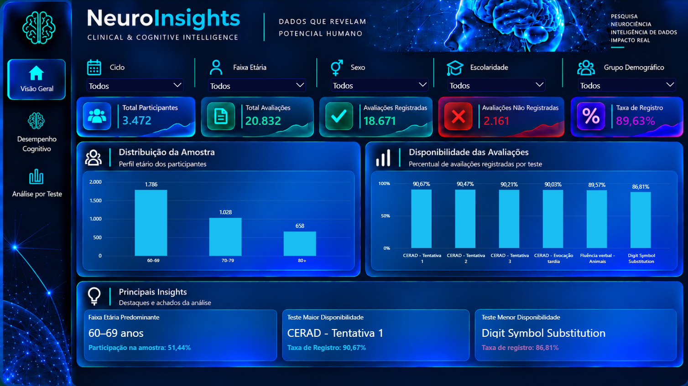
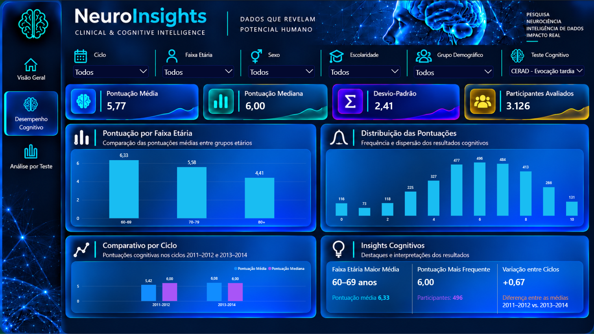
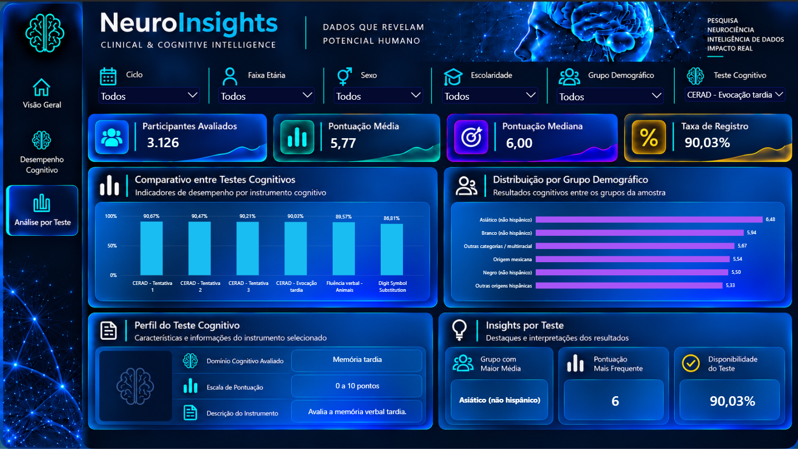

# NeuroInsights | Clinical & Cognitive Intelligence

### Análise exploratória de desempenho cognitivo com Python, Power BI e dados públicos do NHANES

O **NeuroInsights** é um projeto de análise de dados voltado à exploração de indicadores de desempenho cognitivo em adultos com 60 anos ou mais, utilizando informações públicas do **National Health and Nutrition Examination Survey (NHANES)**, disponibilizadas pelo Centers for Disease Control and Prevention (CDC).

O objetivo é transformar dados de avaliações cognitivas em informações acessíveis, por meio de um processo estruturado de extração, tratamento, validação, modelagem e visualização.

O projeto integra **Python, estatística descritiva, modelagem dimensional, DAX e Power BI**, resultando em um dashboard interativo composto por três páginas.

---

## 1. Objetivos

- Explorar o desempenho cognitivo por características demográficas.
- Analisar a distribuição das pontuações dos instrumentos cognitivos.
- Investigar a disponibilidade e a completude dos registros.
- Comparar indicadores descritivos entre os ciclos de pesquisa.
- Construir uma solução analítica reproduzível e documentada.
- Apresentar informações de maneira clara e visualmente acessível.

## 2. Fonte de dados

**Fonte:** National Health and Nutrition Examination Survey (NHANES) — CDC.

**Ciclos utilizados:**
- 2011–2012
- 2013–2014

**Arquivos originais:**
- `CFQ_G.xpt` — avaliações cognitivas, ciclo 2011–2012.
- `CFQ_H.xpt` — avaliações cognitivas, ciclo 2013–2014.
- `DEMO_G.xpt` — informações demográficas, ciclo 2011–2012.
- `DEMO_H.xpt` — informações demográficas, ciclo 2013–2014.

Fonte oficial: https://www.cdc.gov/nchs/nhanes/

Os dados foram integrados utilizando o identificador de participante `SEQN`, com procedimentos de auditoria, verificação de chaves e validação das pontuações.

## 3. Tecnologias utilizadas

| Tecnologia | Aplicação |
|---|---|
| Python | Extração, auditoria, tratamento e validação |
| Pandas | Manipulação e transformação dos dados |
| Parquet | Armazenamento das bases processadas |
| Power BI | Desenvolvimento do dashboard |
| Power Query | Preparação e integração no modelo analítico |
| DAX | Indicadores, estatísticas e insights dinâmicos |
| Git e GitHub | Versionamento e documentação |

## 4. Pipeline de dados

O processamento foi organizado em etapas:

**Extração → Auditoria → Validação → Integração → Tratamento → Modelagem → Visualização**

### Camada de dados brutos

Importação dos arquivos públicos originais do NHANES, preservando a estrutura das fontes.

### Camada Silver

Integração dos ciclos, padronização das variáveis, tratamento dos registros e validação da consistência das informações.

### Camada Gold

Construção de um modelo dimensional para consumo no Power BI, com tabelas de participantes, ciclos, testes, avaliações e informações de amostragem.

**Tabelas principais:**

- `dim_participante`
- `dim_ciclo`
- `dim_teste`
- `dim_amostragem`
- `fato_avaliacao`

## 5. Visão geral da base

| Indicador | Resultado |
|---|---:|
| Participantes únicos | 3.472 |
| Instrumentos/avaliações cognitivas | 6 |
| Avaliações potenciais | 20.832 |
| Avaliações com pontuação registrada | 18.671 |
| Avaliações sem pontuação registrada | 2.161 |
| Taxa geral de registro | 89,63% |

Os indicadores representam a base analítica processada para este projeto, não estimativas populacionais dos Estados Unidos.

## 6. Instrumentos cognitivos analisados

O projeto contempla seis medidas cognitivas:

1. CERAD — Recordação imediata, tentativa 1.
2. CERAD — Recordação imediata, tentativa 2.
3. CERAD — Recordação imediata, tentativa 3.
4. CERAD — Evocação tardia.
5. Fluência verbal — Animais.
6. Digit Symbol Substitution Test (DSST).

Esses instrumentos exploram diferentes aspectos da cognição, incluindo memória verbal, fluência semântica e velocidade de processamento.

**Importante:** como os instrumentos possuem escalas diferentes, suas pontuações brutas não devem ser comparadas diretamente como se representassem uma única medida cognitiva.


## 7. Dashboard interativo

O dashboard NeuroInsights possui três páginas interativas.

### Página 1 — Visão Geral

Apresenta os principais indicadores da amostra, a distribuição dos participantes e a disponibilidade das avaliações cognitivas.



### Página 2 — Desempenho Cognitivo

Explora pontuações, estatísticas descritivas, distribuições e diferenças entre grupos demográficos.



### Página 3 — Análise por Teste

Apresenta indicadores específicos de cada instrumento, perfil cognitivo e insights dinâmicos.



**Arquivo Power BI:** `powerbi/neuroinsights-cognitive-analytics.pbix`


## 8. Principais indicadores DAX

O dashboard utiliza medidas dinâmicas para calcular:

- Total de participantes e avaliações.
- Avaliações registradas e não registradas.
- Taxa de registro por instrumento.
- Pontuação média e mediana.
- Desvio-padrão.
- Distribuição e frequência das pontuações.
- Pontuação mais frequente.
- Comparação descritiva entre ciclos.
- Destaques por faixa etária e grupo demográfico.

As medidas respondem aos filtros disponíveis no dashboard, respeitando o contexto analítico de cada visual.

## 9. Metodologia e limitações

Este projeto possui finalidade **exploratória e descritiva**.

- Os ciclos NHANES utilizados são pesquisas transversais; as comparações entre ciclos não representam acompanhamento longitudinal dos mesmos indivíduos.
- As pontuações dos instrumentos cognitivos possuem escalas e interpretações distintas.
- Diferenças entre grupos podem estar associadas a idade, escolaridade e outros fatores não controlados.
- As estatísticas apresentadas no dashboard são descritivas da amostra analítica.
- A realização de inferências populacionais exige aplicação adequada dos pesos amostrais, estratos e unidades primárias de amostragem do NHANES.
- Os resultados não constituem diagnóstico clínico nem permitem concluir, isoladamente, a presença de comprometimento cognitivo.

## 10. Estrutura do projeto

```text
NeuroInsights/
├── dados/
│   ├── brutos/
│   ├── qualidade/
│   └── tratados/
│       └── gold/
├── docs/
├── powerbi/
│   └── neuroinsights-cognitive-analytics.pbix
├── scripts/
│   ├── 01_download_nhanes.py
│   ├── ...
│   └── 16_auditoria_amostragem.py
├── requirements.txt
├── .gitignore
└── README.md
```

## 11. Execução do projeto

Clone o repositório e crie um ambiente virtual Python:

```bash
python -m venv .venv
```

Ative o ambiente no Windows:

```powershell
.\.venv\Scripts\Activate.ps1
```

Instale as dependências:

```bash
pip install -r requirements.txt
```

Os scripts numerados na pasta `scripts/` documentam as etapas de obtenção, auditoria, processamento e modelagem dos dados.

A execução deve respeitar a sequência e os caminhos de entrada e saída definidos nos scripts. Consulte o código antes de reproduzir o pipeline em outro ambiente.

Para explorar o dashboard, abra o arquivo `.pbix` no Power BI Desktop.

## 12. Considerações finais

O NeuroInsights demonstra a aplicação de técnicas de análise e engenharia de dados a um conjunto de informações de saúde pública, desde a preparação das fontes até a construção de indicadores e visualizações interativas.

O projeto foi desenvolvido como iniciativa independente de portfólio, com foco em qualidade de dados, transparência metodológica, modelagem analítica e comunicação de resultados.

---

**Fonte dos dados:** CDC — National Health and Nutrition Examination Survey (NHANES).

**Projeto independente de análise de dados. Sem finalidade diagnóstica.**